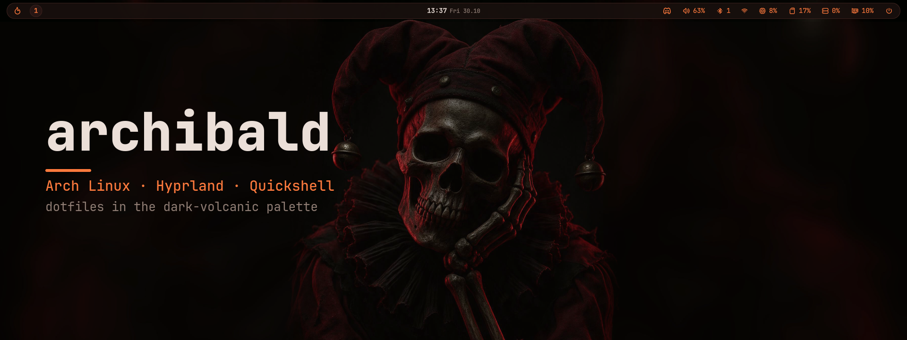
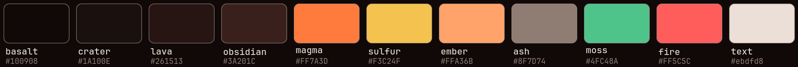
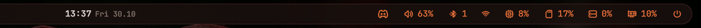

<p align="center">
  
</p>

<p align="center">
  <b>Arch Linux</b> · <b>Hyprland</b> (Lua config) · <b>Quickshell</b> bar · <b>greetd</b> login · <b>zsh</b> ·
  one palette from the login screen to the terminal
</p>

---

## Palette: dark-volcanic

Every color on this machine comes from one set of eleven values. The bar reads them from
`~/.config/quickshell/Theme.qml`; kitty, GTK, bat, rofi, dunst, hyprlock and the greeter carry
copies of the same hex codes.

<p align="center">
  
</p>

Rules of thumb: `magma` is the accent (focused window border, active workspace, bar icons and
values), `sulfur` the secondary accent, `fire` appears only when something is wrong (muted,
offline, a resource above 85 %), `ash` is muted text.

## The bar

<p align="center">
  
</p>

A [Quickshell](https://quickshell.org) shell written from scratch in `~/.config/quickshell`
(no Waybar, no AGS). One bar per monitor, [Tabler](https://tabler.io/icons) line icons from a
local webfont (`Icons.qml` maps names to code points, so the QML reads `Icons.glyph("wifi")`
instead of private-use characters).

| Module | Click | Shows |
| --- | --- | --- |
| Launcher | rofi drun | |
| Workspaces | switch, wheel to scroll | number + an icon per window (Tabler icon by app id); magma on the focused monitor, fire when urgent |
| Clock | | calendar |
| Tray | activate / menu / middle action | themed StatusNotifier menus; known apps get a Tabler icon, others a monochrome version of their own |
| Audio | wheel = volume, middle = mute | sinks, sources, per-application streams (PipeWire) |
| Bluetooth | | adapter switch, paired devices, discovery and pairing (BlueZ) |
| Network | | Wi-Fi networks with inline password entry, wired link, live throughput charts |
| CPU · Memory · Disk · GPU | | 2-minute history charts, per-thread load, temperatures, top processes, filesystems, VRAM |
| Power | rofi power menu | |

Dropdowns are layer surfaces with a Hyprland focus grab, so a click anywhere else closes them.
`qs ipc call bar toggle <name>` opens them from scripts. Everything is translatable through
`I18n.qml` (English source strings, Polish table).

## Login screen

greetd starts a minimal Hyprland whose only client is a second Quickshell config
(`gpu-setup/etc/greetd/quickshell`): blurred wallpaper, clock, user chip, password field with the
same magma → sulfur outline as hyprlock, power buttons. The sources of everything under `/etc/greetd`
live in `gpu-setup/etc/`; a copy of `Theme.qml` rides along because the `greeter` user cannot read
`$HOME`.

## Shell

zsh with the login environment in `~/.profile` (sourced by bash, zsh and greetd alike):

- `cd` is [zoxide](https://github.com/ajeetdsouza/zoxide): `cd proj` jumps by frecency, `cdi` picks with fzf
- Tab completion through [fzf-tab](https://github.com/Aloxaf/fzf-tab) with previews (eza for directories, bat for files)
- `Ctrl-T` files, `Alt-C` directories (both listed by fd), `Ctrl-R` history, all through fzf in palette colors
- `ls` / `ll` / `la` / `lt` → [eza](https://github.com/eza-community/eza) with icons and git status, `cat` → [bat](https://github.com/sharkdp/bat) with a dark-volcanic `tmTheme`
- autosuggestions and syntax highlighting; emacs keys and terminfo-correct Home/End/Delete

## Keys

`mainMod` is **left Alt** (right Alt stays AltGr for Polish letters).

| Keys | Action |
| --- | --- |
| `Alt T` / `Alt E` / `Alt A` | kitty / Nemo / rofi |
| `Alt Q` · `Alt F` · `Alt Shift F` · `Alt P` · `Alt J` | close · fullscreen · float · pseudo · toggle split |
| `Alt ←↑↓→` · `Alt Shift ←↑↓→` | focus · move window |
| `Alt 1-0` · `Alt Shift 1-0` · `Alt wheel` | workspace · move to workspace · scroll workspaces |
| `Alt S` · `Alt Shift S` | special workspace · move window there |
| `Alt [` / `Alt ]` | shrink / grow (repeating) |
| `Alt V` | clipboard history (cliphist + rofi) |
| `Alt W` / `Alt Shift W` | pick wallpaper / next wallpaper |
| `Print` / `Shift Print` | area screenshot (frozen screen) / full desktop |
| `Alt Shift L` | hyprlock |
| `Alt M` | exit Hyprland |

## Hardware notes

Two NVIDIA cards: an RTX 4070 and a Quadro P400 for the host, with a Windows 11 VM taking the RTX
through VFIO and Looking Glass. GRUB gets an extra entry (`gpu-setup/etc/grub.d/11_rtx_host`) that
blacklists `vfio_pci`, so the RTX drives the monitors and games on the host; `hyprland.lua` picks
the DRM devices by PCI address and puts the RTX first whenever it is present. `gpu-setup/etap*.sh`
are the numbered stages that built this (drivers, VFIO, libvirt, the VM definition, Looking Glass).

## Layout

```
~/.profile  ~/.zshrc  ~/.zprofile  ~/.bashrc      login environment, interactive shell
~/.config/hypr/          hyprland.lua (Lua config), hyprlock, hypridle, hyprpaper
~/.config/quickshell/    the bar: shell.qml, Theme.qml, Icons.qml, bar/, popups/, components/, services/
~/.config/kitty/  bat/  gtk-3.0/  gtk-4.0/  rofi/  dunst/     dark-volcanic for each
~/.config/dotfiles/      ignore (whitelist of this repo), readme/ (these images)
~/.local/bin/            dotfiles, screenshot, wallpaper, clipboard-store, rofi-power, papirus-volcanic, discord-openh264
~/.local/share/fonts/    tabler-icons (the bar's icon font)
~/Pictures/Wallpapers/   the two wallpapers + sources and licenses
~/gpu-setup/             VFIO / VM stages, libvirt XML, sources of /etc/greetd and grub.d
```

## Install

The repository is a bare git repo with `$HOME` as its work tree; files stay where their programs
expect them and `~/.config/dotfiles/ignore` whitelists what is versioned.

```sh
git clone --bare https://github.com/segmentationf4u1t/archibald.git ~/.dotfiles
git --git-dir=$HOME/.dotfiles --work-tree=$HOME checkout   # move away files it refuses to overwrite (e.g. a stock ~/.bashrc)
dotfiles status            # ~/.local/bin/dotfiles wraps git with the right --git-dir and excludes file
```

Packages (Arch, `extra`):

```sh
sudo pacman -S hyprland quickshell hyprpaper hyprlock hypridle kitty rofi dunst nemo \
  zsh zsh-autosuggestions zsh-syntax-highlighting eza bat fd fzf zoxide \
  grim slurp wl-clipboard cliphist playerctl blueman greetd \
  ttf-jetbrains-mono-nerd noto-fonts papirus-icon-theme adw-gtk-theme
chsh -s /usr/bin/zsh
```

Then the pieces that are generated or come from elsewhere:

```sh
git clone --depth 1 https://github.com/Aloxaf/fzf-tab ~/.local/share/zsh/plugins/fzf-tab
papirus-volcanic                     # builds ~/.local/share/icons/Papirus-Dark-Volcanic (magma folders)
bat cache --build                    # registers the dark-volcanic bat theme
sudo cp -r ~/gpu-setup/etc/greetd /etc/ && sudo cp ~/gpu-setup/etc/tmpfiles.d/greetd-greeter.conf /etc/tmpfiles.d/
sudo systemd-tmpfiles --create && sudo systemctl enable greetd
```

Settings that are not files (set once): `gsettings set org.gnome.desktop.interface icon-theme
Papirus-Dark-Volcanic`, Nemo list view and `kitty` as its terminal.

## Credits

- [Tabler Icons](https://tabler.io/icons) (MIT) · [Papirus](https://github.com/PapirusDevelopmentTeam/papirus-icon-theme) (GPL-3.0), recolored by `papirus-volcanic`
- [JetBrains Mono Nerd Font](https://www.nerdfonts.com) · [adw-gtk3](https://github.com/lassekongo83/adw-gtk3)
- `volcanic-contour-line.png` is [rose-pine/wallpapers](https://github.com/rose-pine/wallpapers) `contour-line` (CC0) mapped onto this palette; `seedream-dark-jester.jpg` is a Seedream 5.0 Pro generation (see `Pictures/Wallpapers/SOURCE.txt`)
- The dark-volcanic palette comes from the `oh-my-pi` terminal theme of the same name
